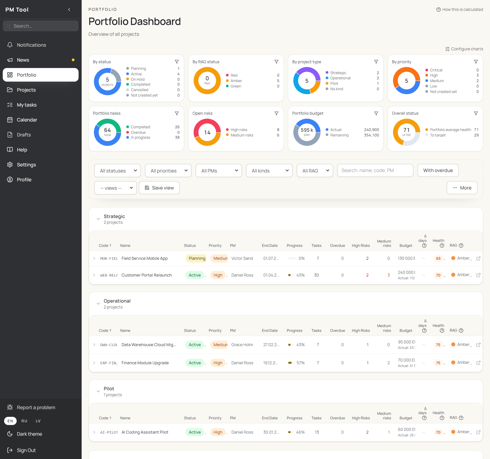
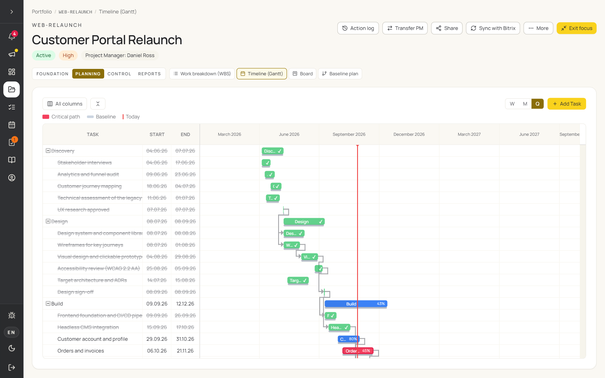
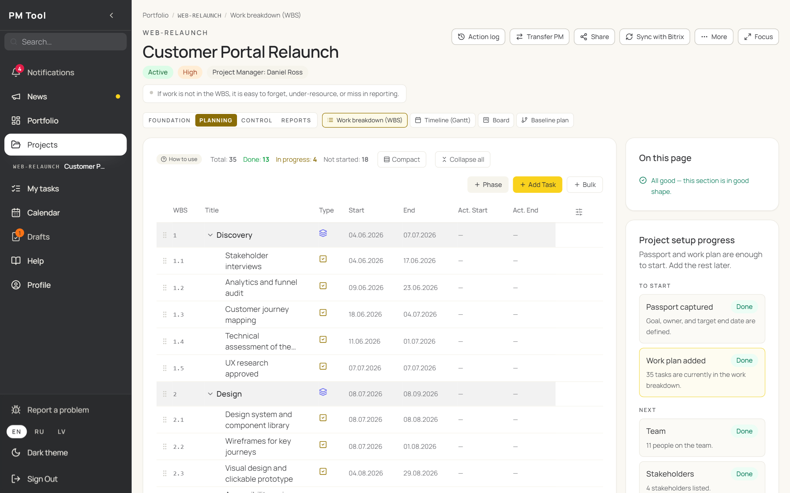
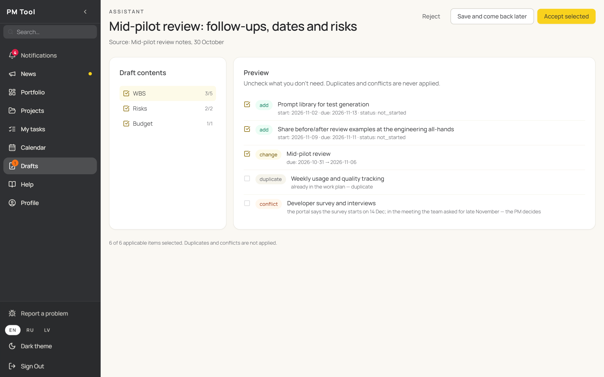
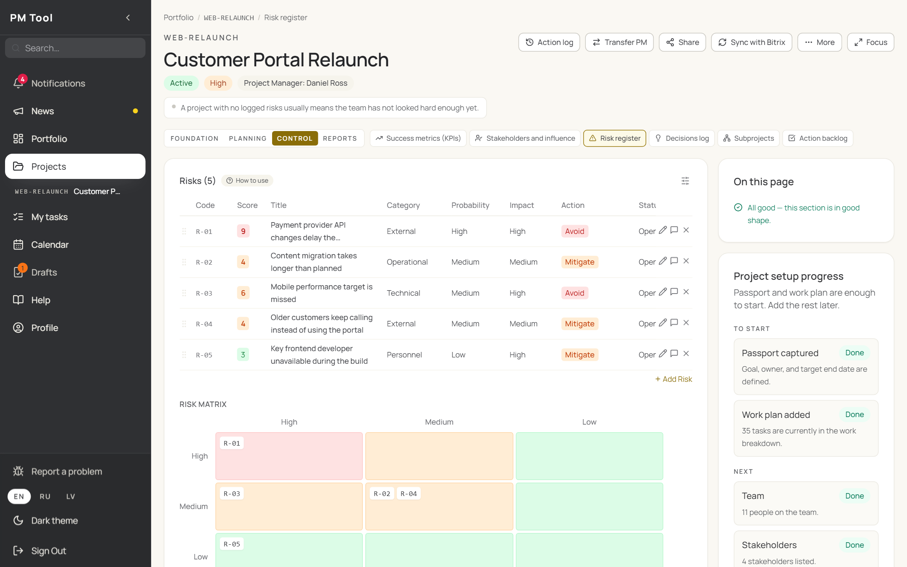
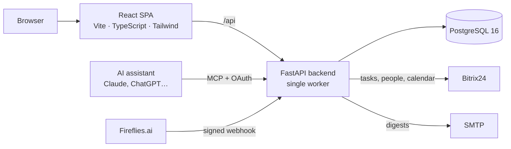

<div align="center">

# 📊 PM Tool

**A project & portfolio management portal with an AI assistant built in — designed and shipped by a project manager working with AI coding agents.**

Project passports, WBS and Gantt, risks, budgets, meetings and status reports in one place —
plus an MCP server, so assistants like Claude can read the portfolio and *propose* changes for a human to review.

[](LICENSE)
[](#-tech-stack)
[](#-tech-stack)
[](#-tech-stack)
[](#-ai-inside)
[](#-project-status)

</div>

---

## Why PM Tool?

I'm an IT project manager. Project status was spread across spreadsheets and a task tracker, so a consolidated
picture of the portfolio took manual work every time someone asked for it. I wanted one place where that picture
is always current — so I built it, and it is now in daily use by project managers and management.

I built it the way I believe software will increasingly be built: **I owned the product, the architecture
decisions and the review; AI coding agents (Claude Code) wrote most of the code** under strict guardrails —
tests first, byte-level API contracts, visual regression, and multi-agent adversarial code review.
This repository is a sanitized snapshot of that work.

## 📸 Screenshots

<p align="center">
  
</p>

<p align="center">
  
  &nbsp;
  
</p>

<p align="center">
  
  &nbsp;
  
</p>

<p align="center"><sub>All data in the screenshots is fictional.</sub></p>

## 🤖 AI inside

- **MCP server for AI assistants.** The portal speaks the [Model Context Protocol](https://modelcontextprotocol.io).
  An assistant connected through OAuth (with an explicit consent screen) or a personal token can list projects,
  read a project card or any section, create a project and propose changes to an existing one. Every token carries
  a scope: read-only, or read plus drafts.
- **Human in the loop by default.** Changes to an existing project arrive as a **draft** that the project manager
  reviews item by item before anything is applied. The assistant labels every item *add*, *edit*, *delete*,
  *skip* (a duplicate it noticed) or *clash* (it contradicts what is already in the portal); the server validates
  the labels, never applies skips or clashes and treats an unknown label as a clash. For bulk migrations the
  portfolio owner can switch on an audited auto-apply mode for their own assistant; new projects created through
  the assistant are written directly.
- **Meeting notes from Fireflies.ai** (optional, off by default). A signed webhook tells the portal that a summary is ready; the portal fetches
  it from the Fireflies API and matches it to the right project meeting by the video-meeting link and time window,
  with fuzzy attendee-name matching across English, Latvian and Russian spellings as a fallback. Private meetings
  are never published. Optionally the notes are also posted to the Bitrix24 calendar event (this needs a custom
  Bitrix24 REST method that is not part of this repository).
- **RAG health and a built-in advisor.** Projects turn amber or red from overdue work and unmitigated risks
  (thresholds are configurable), and an advisor on every page points at what is missing: tasks without dates or
  owners, too few KPIs, critical risks without a mitigation plan.

## ✨ Features

- **Portfolio dashboard** — RAG health of every project, portfolio budget plan vs actual, attention list;
  a weekly leadership e-mail digest when SMTP is configured.
- **Project workspace with 17 sections** — passport, team, stakeholders, assumptions, communication plan, KPIs,
  WBS, Gantt (dependencies, critical path), baseline plan, Kanban, risks, decisions, budget (by year and month,
  plan vs actual), subprojects, backlog, meetings (agenda → minutes → decisions → actions that become tasks)
  and status reports.
- **My work & calendar** — everything assigned to me across projects, meetings and deadlines in one view.
- **Bitrix24 integration** — tasks are pushed to executors who never need to log in; people directory sync.
- **Excel import** of the PM office's project templates.
- **Read-only share links** for people outside the portal.
- **Audit trail** — action log and passport version history; optimistic locking against lost updates.
- **Built-in wiki and "what's new" feed**, both in three languages.
- **English, Latvian and Russian UI**; light and dark modes, each in a Warm (default) or Classic style.

## 🧪 Engineering

| | |
|---|---|
| Backend tests | **721** pytest tests, pyright with 0 errors |
| Frontend tests | **329** Vitest tests, TypeScript in strict mode |
| End-to-end | **18** Playwright specs — user flows, visual regression, accessibility; they run against a local development dataset that is not included, as are the visual baselines |
| API contract | byte-level "golden" snapshots of API responses, compared before and after every refactor |
| CI | GitHub Actions: type checks, unit tests, dependency audit, Docker image hardening |
| AI workflow | [`AGENTS.md`](AGENTS.md) as the single source of guidance for any coding agent, portable skills in `.agents/skills`, multi-agent review |



More detail: [ARCHITECTURE.md](ARCHITECTURE.md) · [pmo-backend/SECURITY.md](pmo-backend/SECURITY.md) · [deploy/DEPLOY.md](deploy/DEPLOY.md).

## 🚀 Getting started

Requires Docker.

```bash
git clone https://github.com/bykcyc/pmo-portal.git
cd pmo-portal
docker compose up -d --build
```

Open <http://localhost:3000> and sign in with a development seed account:

| Role | Email | Password |
|---|---|---|
| Portfolio owner | `owner@company.com` | `admin123` |
| Project manager | `pm1@company.com` | `pm123` |

These accounts exist for local development only — a production deployment refuses to start while they still
accept the default passwords. The interface opens in Russian; switch to **EN** in the sidebar.
Integrations (Bitrix24, Fireflies, SMTP) are optional: copy `pmo-backend/.env.example` to `pmo-backend/.env`
and fill in what you need.

Run the checks:

```bash
# backend — Python 3.11+
cd pmo-backend
python -m pip install -r requirements.txt pytest pyright
python -m pytest -q && pyright

# frontend — inside the running container
docker compose exec frontend sh -lc "npx tsc --noEmit && npx vitest run"
```

## 🧱 Tech stack

FastAPI · asyncpg · PostgreSQL 16 · APScheduler · MCP Python SDK · React 18 · Vite · TypeScript · Tailwind CSS ·
TanStack Query · Zustand · react-hook-form + Zod · i18next · dhtmlx-gantt · Recharts · Playwright · Vitest ·
pytest · pyright · Docker Compose · Caddy (production).

## 📌 Project status

This is a **frozen public snapshot** of a private, actively developed codebase. It is not maintained here:
issues and pull requests may go unanswered. Code comments and internal docs are mostly in Russian; the user interface is fully available in English.

## ⚖️ Third-party components

PM Tool's own code is MIT-licensed. Dependencies keep their own licenses — notably **dhtmlx-gantt** (Standard
edition, GPL-2.0) and **SheetJS** (Apache-2.0). Bitrix24, Fireflies.ai and other services are trademarks of their
owners.

## ❤️ Support

If this project is useful or inspiring, you can **[buy me a coffee](https://buymeacoffee.com/bykcycd)** ☕

## 📄 License

[MIT](LICENSE) © Jurijs Ivanenko
